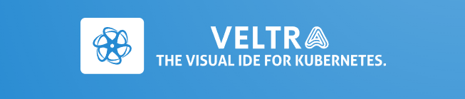
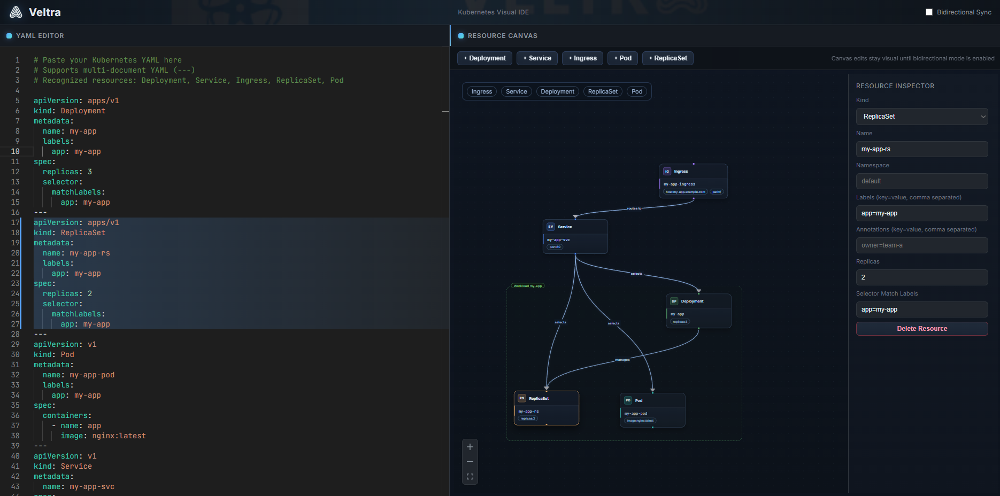

<p align="center">  </p> <h1 align="center" style="font-size: 48px;">Veltra</h1>

<p align="center">
  <b>Design, understand, and evolve Kubernetes infrastructure visually - without losing YAML control.</b>
</p>

<p align="center">
  
</p>

## What is Veltra?

Veltra is an open-source visual Kubernetes IDE that keeps your YAML and infrastructure canvas in sync.  
Instead of forcing teams to choose between raw manifests and visual modeling, Veltra combines both in one workflow.

Kubernetes YAML is powerful, but it becomes difficult to reason about as systems grow. Veltra helps developers:

- see relationships between resources at a glance
- edit manifests with confidence
- understand architecture changes before shipping them

## Features

- **YAML Editor** powered by Monaco for a familiar, code-first experience
- **Visual Canvas** for infrastructure modeling and resource relationships
- **YAML <-> Canvas Sync** (work in progress) to bridge visual and manifest editing
- **Architecture Visualization** to make clusters easier to communicate and review

## Demo / Screenshots




## Tech Stack

- **React + TypeScript**
- **React Flow**
- **Monaco Editor**
- **Zustand**
- **js-yaml**
- **Vite**

## Getting Started

```bash
git clone https://github.com/AyoubManai01/veltra.git
cd veltra
npm install
npm run dev
```

Open the local URL from your terminal (usually `http://localhost:5173`).

## Example YAML

```yaml
apiVersion: apps/v1
kind: Deployment
metadata:
  name: veltra-api
  labels:
    app: veltra-api
spec:
  replicas: 2
  selector:
    matchLabels:
      app: veltra-api
  template:
    metadata:
      labels:
        app: veltra-api
    spec:
      containers:
        - name: api
          image: nginx:stable
          ports:
            - containerPort: 80
---
apiVersion: v1
kind: Service
metadata:
  name: veltra-api
spec:
  selector:
    app: veltra-api
  ports:
    - port: 80
      targetPort: 80
```

## Roadmap

### Current

- [x] Basic YAML editing experience
- [x] Initial visual canvas foundation
- [x] Local development setup with Vite + React + TypeScript

### Upcoming

- [ ] Reliable bidirectional YAML <-> canvas synchronization
- [ ] Resource validation and diagnostics
- [ ] Multi-resource graph navigation
- [ ] Export/import project states
- [ ] Collaboration-friendly sharing flows

## Contributing

Contributions are welcome and appreciated.  
Please read [`CONTRIBUTING.md`](./CONTRIBUTING.md) to get started.

## License

This project is licensed under the **MIT License**.

## Vision

**Veltra aims to become the Figma for Kubernetes infrastructure** - a place where teams can design, understand, and iterate on cloud architecture with speed and clarity.
